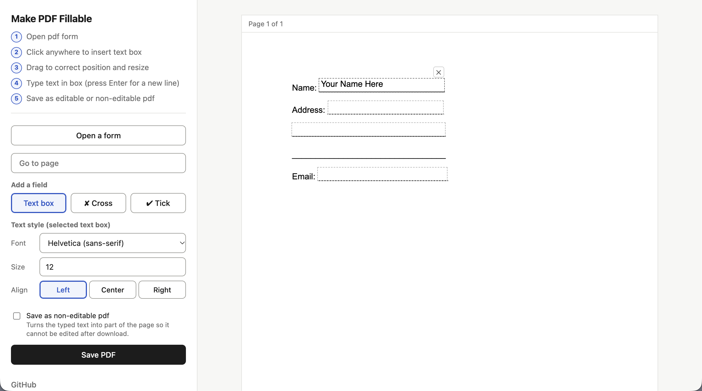

# Make PDF Fillable
A free, open source offline tool to add fillable fields to a pdf form.

- Minimal features - app is simple to use, no learning curve.
- Create fillable form once and then reuse. Fields continue to be editable after pdf is downloaded (Use your device's "print as pdf" feature to make a pdf non-editable).
- Runs locally and offline. No data leaves your device.
- Easy to modify or to add features using vibe coding. Simply pass the index.html file to an LLM like Claude Sonnet and tell it what changes you want.
- No restricted features, no paywalls, no watermarks, no ads.

Live demo: 
https://make-pdf-fillable.woza.work/

I created this tool to support those who help immigrants and refugees complete official paperwork. By using this tool they can save time by typing in info instead of handwriting. This way they can help more people at a faster pace. 

Many official forms are printed copies so volunteers end up handwriting on them. Converting to pdf and then typing is faster, more legible and easy to correct. Privacy is important because these forms hold sensitive personal data.

 

Minimalist UI

 

## How to use offline
Download the project folder and place it on your desktop. Then double click the index.html file. The app will open in your browser.

 

## Revision History

Version 1.0 
26-October-2026 
First release.

 
